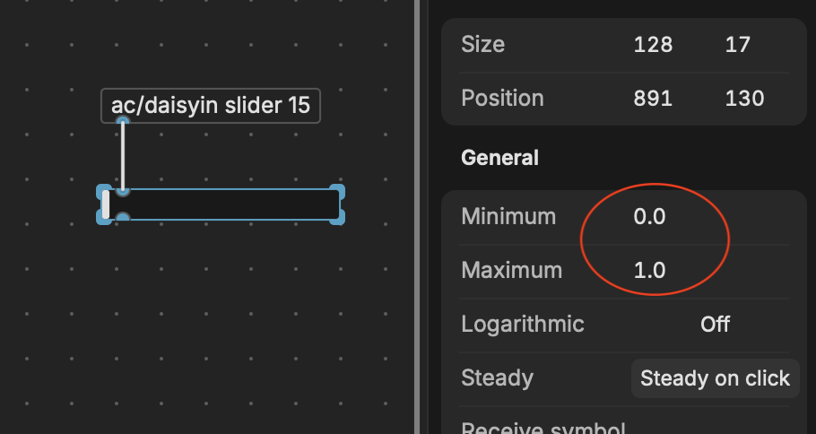
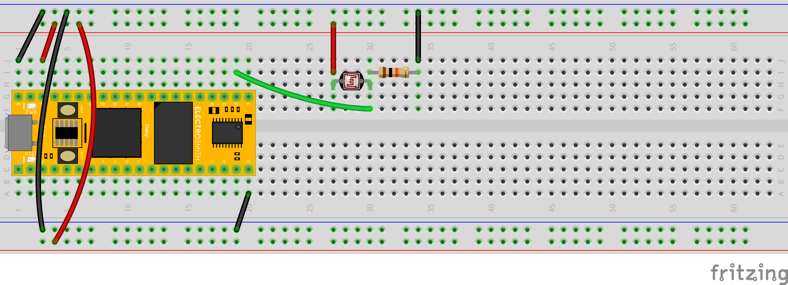
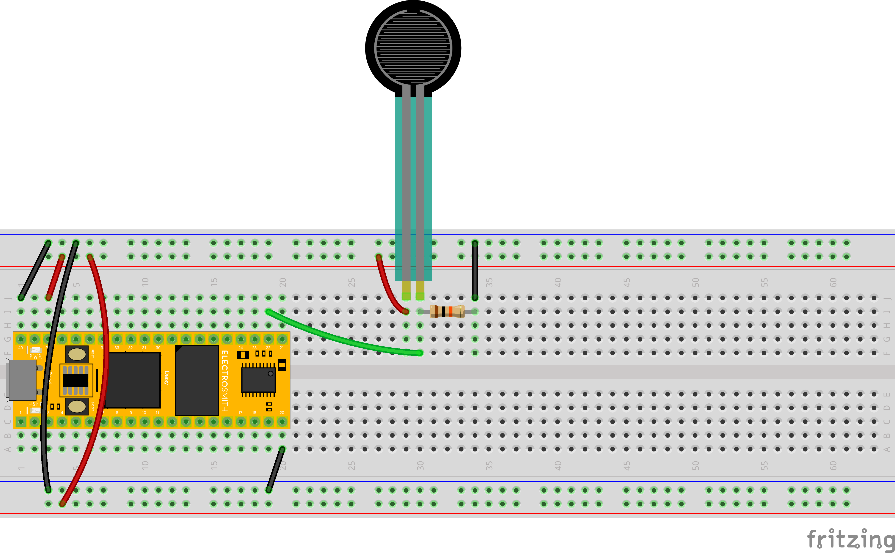

# Basic Sensors

A potentiometer is a straightforward way to capture variable information and use it to control a slider in Pd. However, many sensors behave exactly the same way electrically (as a "voltage divider") while opening up different possibilities for interaction.

For all of these sensors, use this in the "components" section of your `compile.json`:
```json
       "sliderX": {
           "component": "AnalogControl",
           "pin": X
       },
```

...and in Pd, connect `ac/daisyin slider X` to a slider with a minimum of 0.0 and maximum of 1.0 set in its properties:

<p align="center">
    
</p>

And here's the pinout for reference:

<p align="center">
    
</p>


## Photocell

Variation in light level determines voltage drop across the photocell. There is a lot of variation between parts, so you may need to calibrate your patch accordingly.


### Daisy

Wire one side of the photocell to `+` and the other to `-` through a 10kΩ resistor. Read the voltage on an analog pin (15–25) from the negative side of the photocell:

<p align="center">
    
</p>


## FSR

A "Force-Sensitive-Resistor" varies the voltage drop across it when it is squeezed. There is a lot of variation between parts, so you may need to calibrate your patch accordingly.


### Daisy

Wire one side of the FSR to `+` and the other to `-` through a 10kΩ resistor. Read the voltage on an analog pin (15–25) from the negative side of the FSR:

<p align="center">
    
</p>