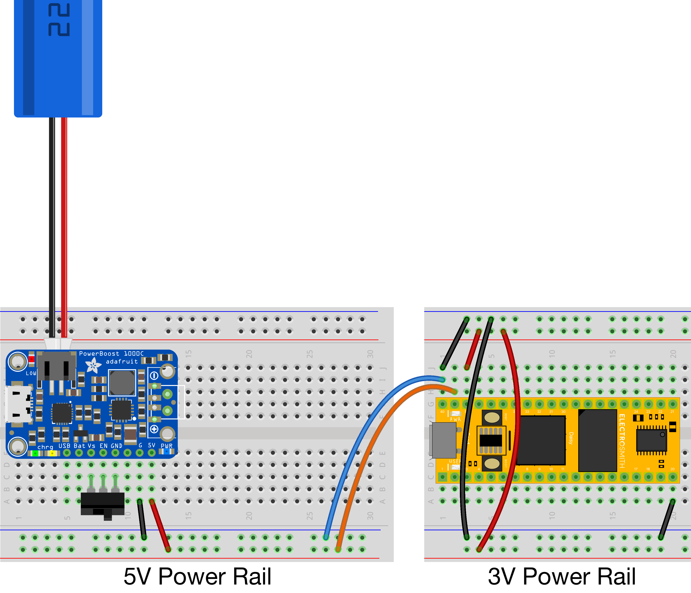
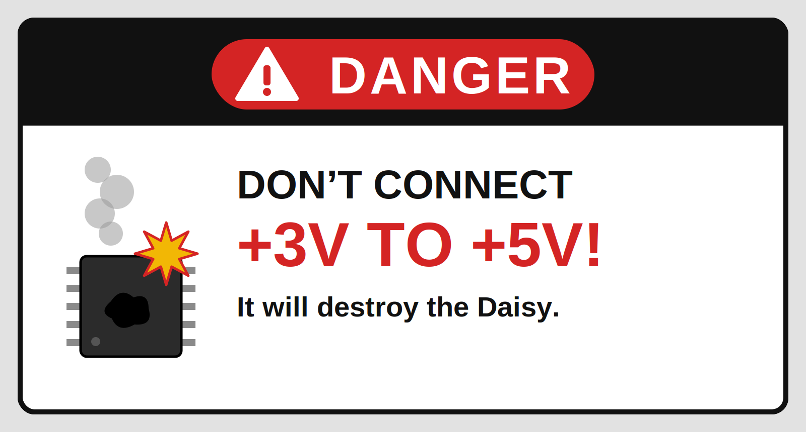
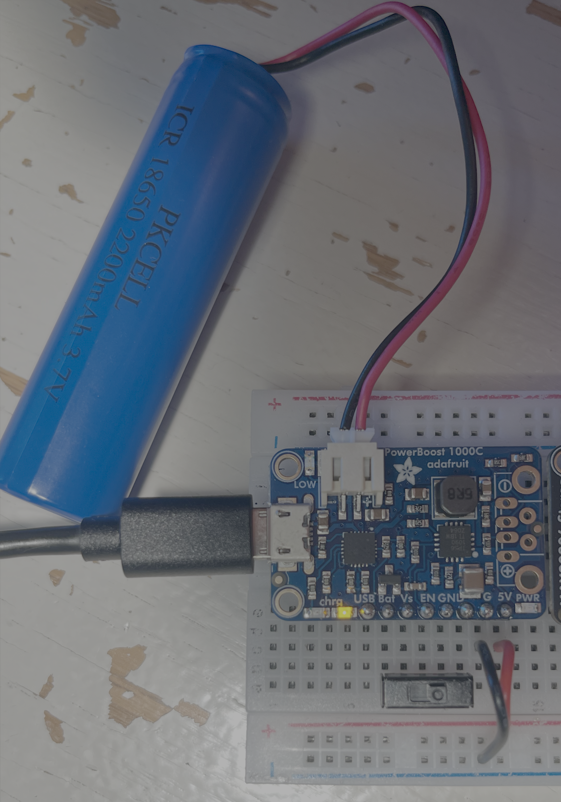
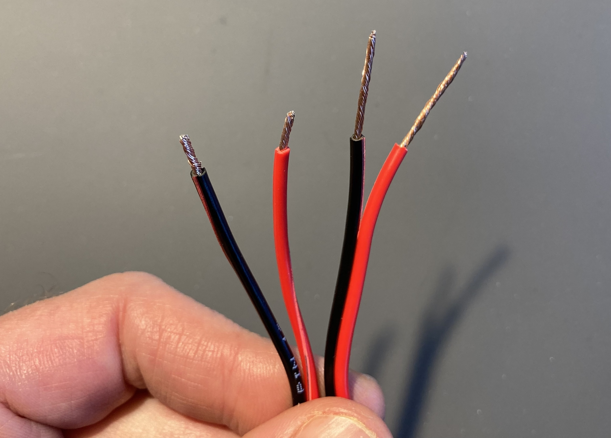
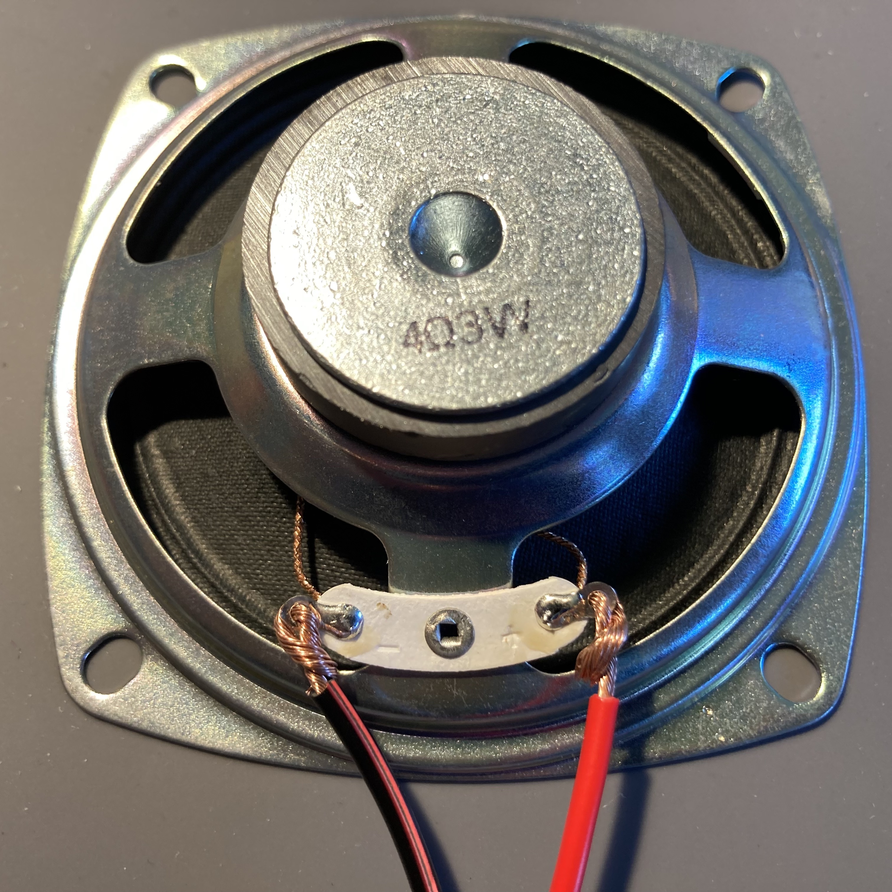
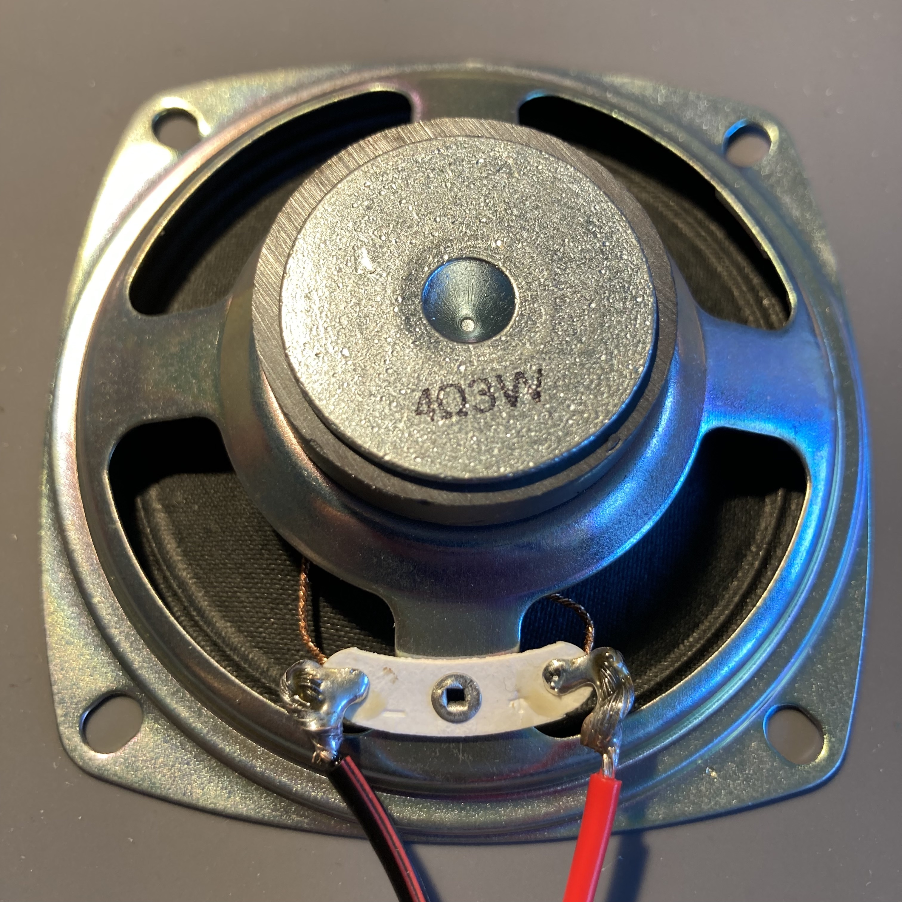
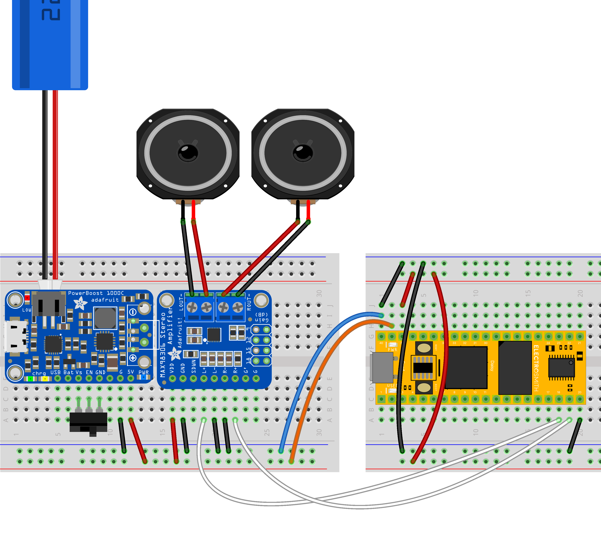
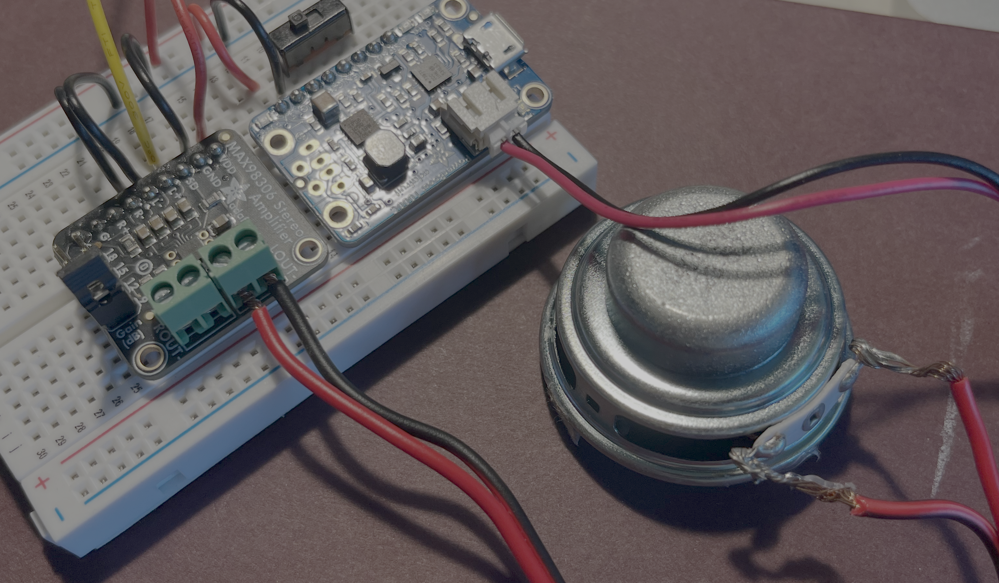

# Portable Power and Sound

Powering the seed from its USB jack might be useful for some things, but it kind of defeats the purpose if we are always tethered to a computer. Instead, we can build a battery-power module to make our systems portable. And by working with a built-in amplifier and speakers, we can free our instruments from cables entirely.

## Running on Battery Power

### Materials
- Preexisting Daisy circuit
- Small breadboard
- PowerBoost 1000C power supply
- 3.7V 2200mAh rechargable battery
- Breadboard toggle switch
- Solid core: red + black
- Stranded core: orange + blue
- micro-USB cable

This circuit eliminates the need to have the Daisy plugged in to USB for power (you can still plug it in for patch loading purposes).

It makes use of the PowerBoost 1000C, an electronics board that regulates a 3.7V battery to the 5V necessary to power a Daisy. It includes a micro-USB socket so that you can also charge the battery using your computer. (Yes, you might end up with two USBs plugged in to your machine—one to charge the battery, one to load patches on the Daisy)

The pins on a PowerBoost are set up so that you can wire in a power switch—or just use a breadboard-friendly toggle by placing it across the `Vs`, `EN`, and `GND` pins.

    

Notice above that pin on the PowerBoost that goes to the rail is marked `5V`. We are doing this on a separate breadboard, because this is a different voltage than the `3V` power rails provided by the Daisy.

    

You can, however—and must—connect the grounds `-` as well as the 5V power rail to the `5V BAT` pin on the Daisy. The schematic above does this with stranded wire to show the separation (and to suggest stranded wire if you mount the boards separately).

Keep the toggle in the off position (toward `GND`). Connect a battery, and connect the USB socket to a computer. An amber light indicates that the battery is charging; a green one shows that it is fully charged. At any point you can disconnect the computer.

    

When you flip the switch, if there's enough charge, the Daisy will run.

## Using a Built-in Amplifier + Speakers

### Materials
- Preexisting Daisy circuit
- PowerBoost circuit
- MAX98306 breakout board
- Solid core: red + black
- Stranded core: white
- One or two speakers (4Ω or higher and rated for at least 3W)
- 18 or 20 gauge speaker wire

### Preparing the speakers

There are two important specifications for speakers:
- Ohms (Ω): this is the resistance that the speaker offers to the circuit. The amplifier has to be prepared for this—too many ohms aren't a problem, but too few mean the amp gets more current than it is expecting and can fry.
- Watts (W): this is the amount of power that the speaker can handle. Go above this too often, and the speaker will burn out (or tear). 

The MAX98306 puts out 3W when connected to a 4Ω circuit. So ideally the numbers on the speaker match or are higher. If the speaker is too big, that's fine, the amp just won't be able to put much sound out through it.

To wire a speaker, we use speaker wire, which is really two stranded wires stuck together—red for the positive pole of the speaker, and black for the negative. 18 or 20 gauge is good for our purposes (this is the thickness of the wire—the higher the number, the thicker). All we have to do is solder the connection.

1. Use the cutter on your strippers to cut the length of speaker wire that you want.
1. Separate an inch or two of the wires on both ends.
1. Strip off about 1/4" of insulation of each wire on one end, and about 3/4" off each on the other. Look at the labels on the strippers to find the appropriate hole for your wire's gauge on the coarse strippers.
1. Twist the strands together on all the ends.

    

1. Take the longer leads, and match the black wire to - and red to + on the connection tabs of your speaker. Feed them through the holes halfway down the exposed copper, taking care not to let any strands separate off and not to damage the speaker cone on the other side. 
1. Fold the wires and twist them around themselves. Position the wires so that they extend flat, aligned with the face of the speaker rather than poking out perpendicular from it.

    

1. With your soldering iron, heat the joint between the speaker tab and the stranded wire ends. Feed solder into the joint until it is completely covered. Do not skimp on the solder. When you're done, there should be no wiggle in the joint.

    

### Setting up the amplifier

The MAX98306 is a stereo amplifier that runs on 5V. This makes it a good pairing with the PowerBoost, and we can add it to our 5V breadboard. This means that we can attach speakers and eliminate the need for an external amp altogether.

In this schematic, the MAX98306 sits next to the PowerBoost. It's connected to the 5V power rail from its `VDD` and `GND` pins, respectively. `L-` and `R-` also go to `-` on the rail. Finally, there are connections to `L OUT` and `R OUT` on the Daisy (remove all other jacks that you might have connected to these pins if you've been using an external amplifier).

    

The MAX98306 has two "terminal blocks," one for each channel of stereo audio, that have two slots for each side of speaker wire. Use a small screwdriver to gently loosen the screws on the terminal blocks, slide in your twisted wires, and gently screw them down again. Be careful that the negative side of the speaker wire goes on the outside of the terminal block—the two channels are wired as a mirror image.

It is fine to use just one speaker if you are making a mono instrument.

    

