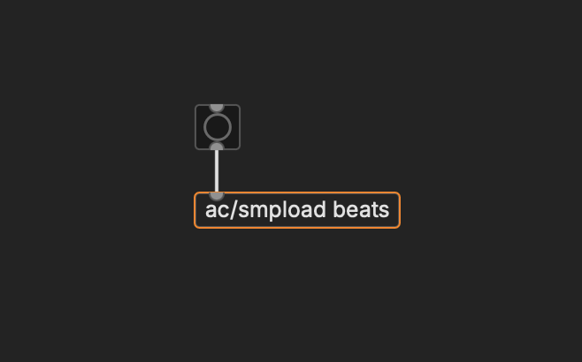
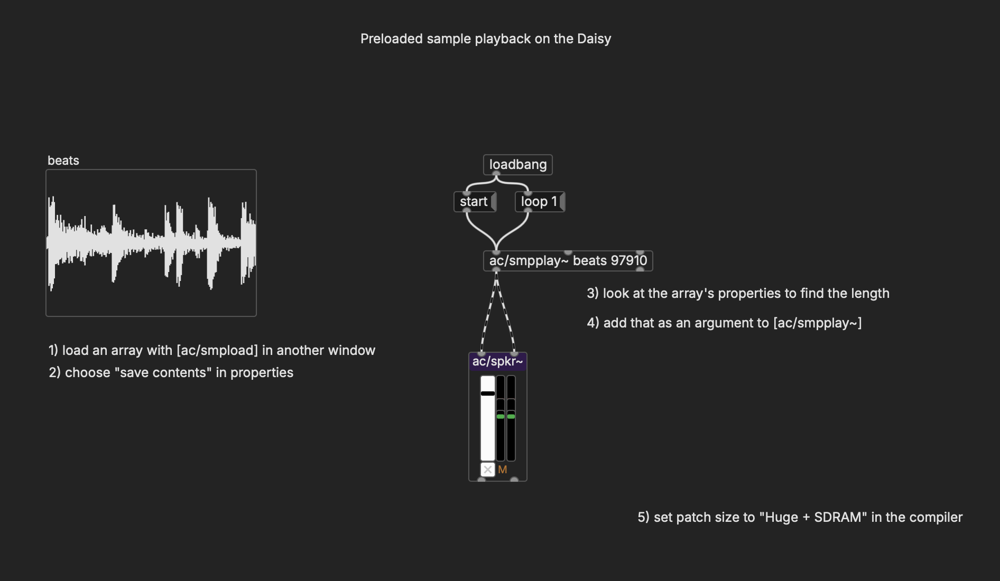
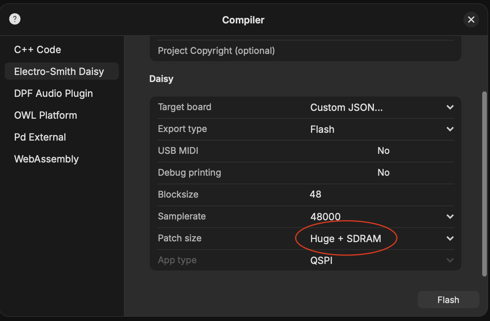
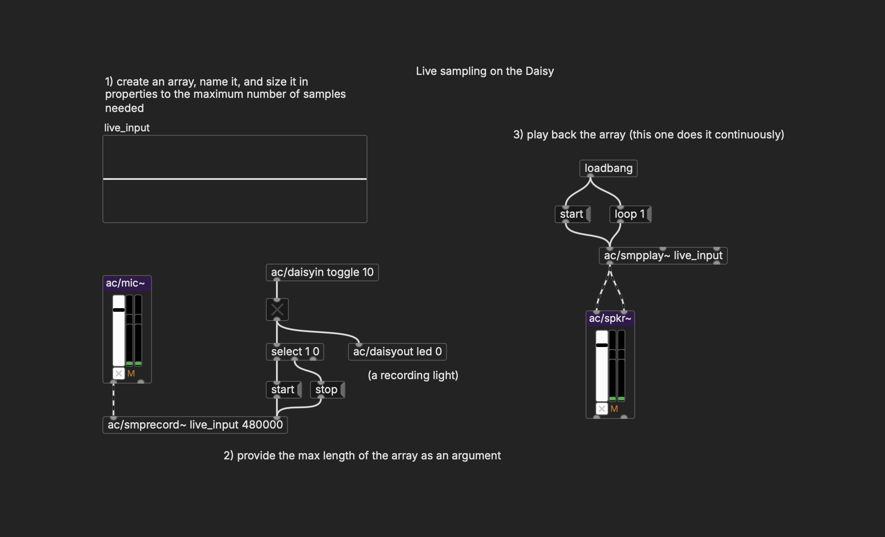
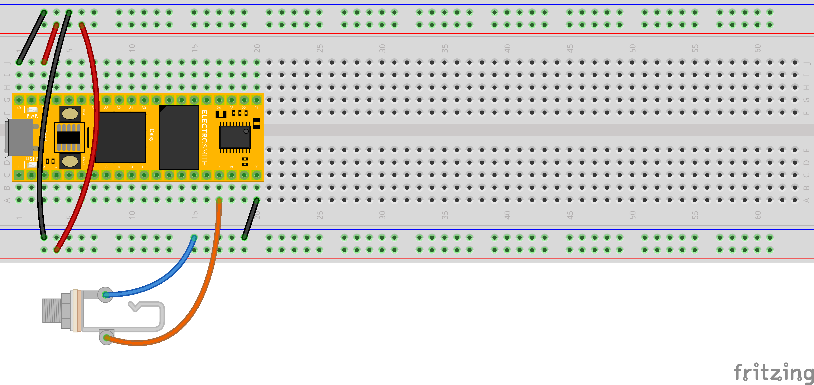
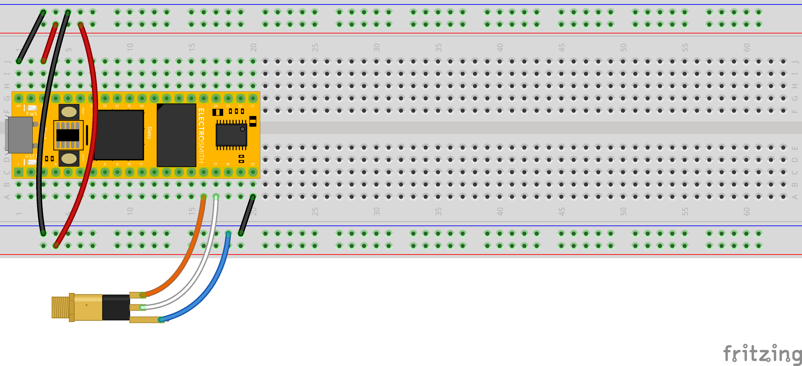
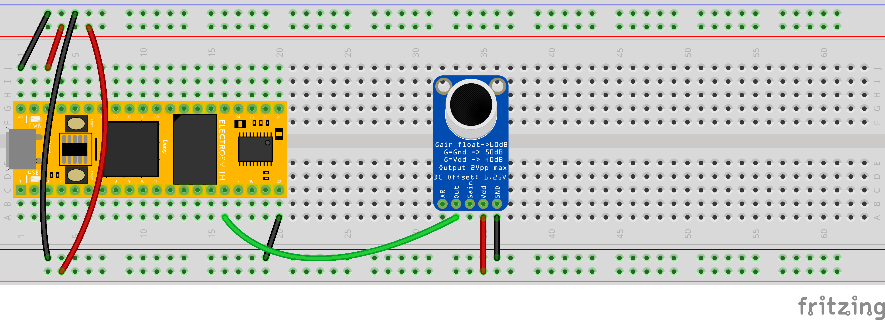

# Arrays: Sampling and Live Input

Just like on the desktop, we can work with arrays on the Daisy. There are a few important caveats, however, that we will discuss in this section.

## Loading and Playing Samples

The Daisy can play back prerecorded samples that are saved with the patch. However, `ac/smpload` will not compile, so we need to put it in a separate patch that only lives on the desktop; Pd patches can communicate between windows.

So, in one patch we have this:

    

And then then the actual array goes in another patch, which is flashed to the Daisy. Two important things we need to do once the sample is loaded in the array: 

- Choose "Save Contents" in the array properties
- Copy the array size from the properties, and add it as a second argument to the player: `ac/smpplay~ ARRAYNAME ARRAYSIZE`

Once we do this, we should be able to trigger playback of the sample.

    

...however, there is a significant limit:

**The maximum total time for all preloaded samples is ~2.5 seconds**

That's not a lot. And to get that much, we need to change a setting on compile:

    

"Huge" here is the 512KB size of internal RAM of the program, saved arrays included. But apart from this restriction, preloaded samples work.

## Recording Samples

Thankfully, the size restriction doesn't apply to recording samples while the Daisy is running. For that, we have the full SDRAM capacity, which is 64MB, over 5 minutes. Compiling with "Huge + SDRAM" applies here as well.

Like always, when we create the array, we have to specify its maximum size in samples (number of seconds x 48,000). This time, we'll also put that maximum size as the second argument in the recorder: `ac/smprecord~ ARRAYNAME ARRAYSIZE`. This ensures that we'll always stay within bounds. We don't need to specify the arraysize for `ac/smpplayback~`.

    

`ac/mic~` has two outlets, one for each channel. These correspond to the `L IN` and `R IN` pins on the Daisy. These are expecting a "line-level" audio signal: an audio cable from a synth, computer, or phone would work, but a bare microphone or guitar are likely too quiet (guitars are possible through the use of a preamp with line-out).

We can wire 1/4" (mono) or 1/8" (stereo) input jacks to the Daisy in the same way we added the audio out, connecting one side to ground and the other to the pin(s):

    

    

In addition, we also can use an electret microphone breakout board. This includes a gain boost in order to bring the output of the built-in microphone to line level:

    

