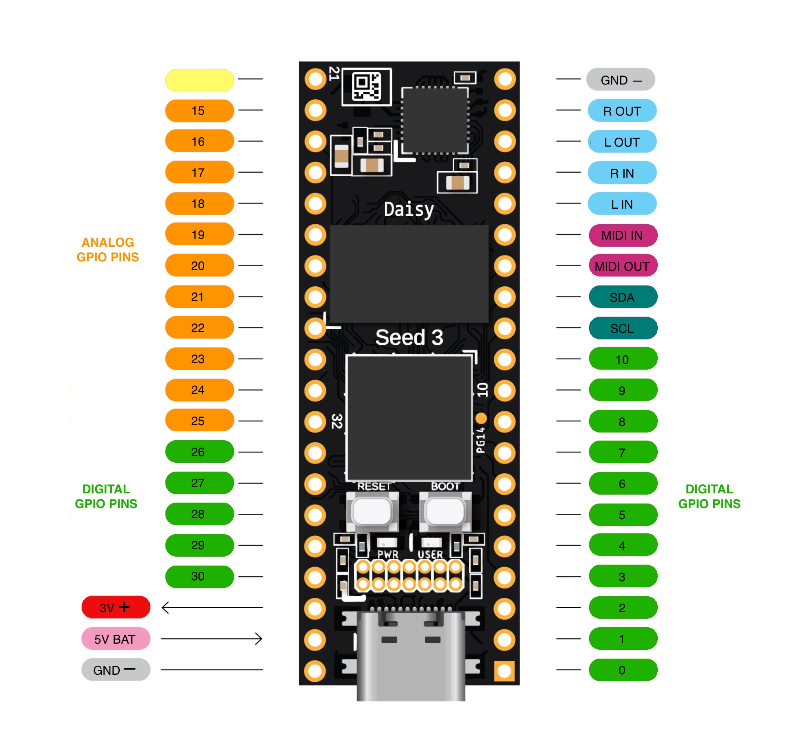
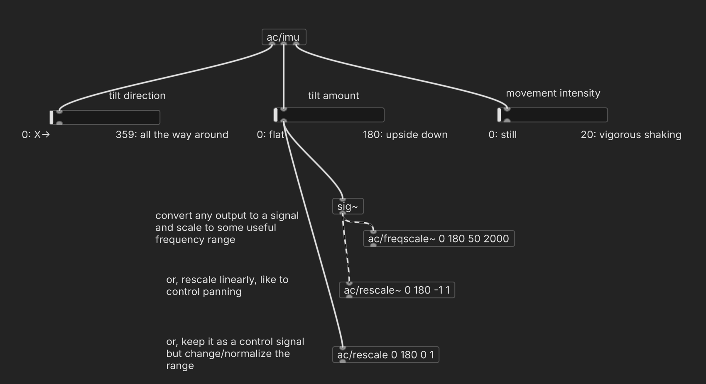

# Digital Sensors

Some sensors are not just basic voltage dividers but include their own chips with specialized processing. In these cases, the result is not just a scalar stream of values, but several processed values. The Daisy can work with sensors like these by receiving data through its "I2C protocol bus"—the digital connection on the SDA/SCL pins.


Here's the pinout for reference:

<p align="center">
    
</p>


## IMU

An "inertial measurement unit sensor" includes an accelerometer, gyroscope, and magnetometer to determine how it is oriented in space.

Our implementation focuses on the accelerometer and outputs three streams of values:
- Tilt Direction, 0–360 degrees
- Tilt Amount, from 0 (flat) to 180 (upside down)
- Movement Intensity, from 0 (still) to 20 (vigorous shaking)

With this, you can control characteristics of your patch by tilting it in different directions by certain amounts, and changing the tilt suddenly or over time.

### compile.json

Use SDA and SCL pins:
```json
        "imu": {
            "component": "Icm20948",
            "pin": { "sda": 12, "scl": 11 }
        },
```

### Pd

Connect `ac/imu` to several sliders (adjust their ranges in properties):


<p align="center">
    
</p>

### Daisy

Wire the VIN to `+`, GND to `-`, and the `SDA` and `SCL` pins on the IMU to the respective pins on the Daisy.


<!-- fritz diagram goes here -->