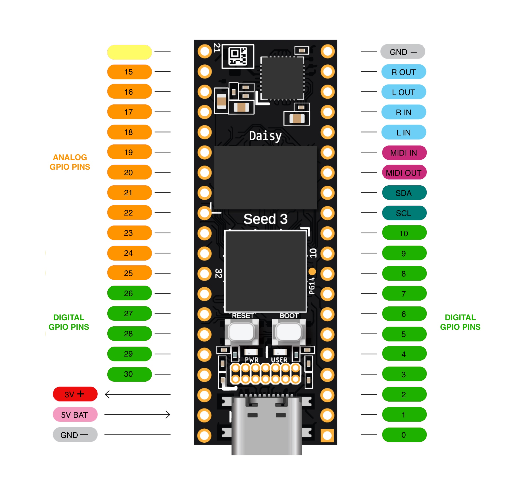
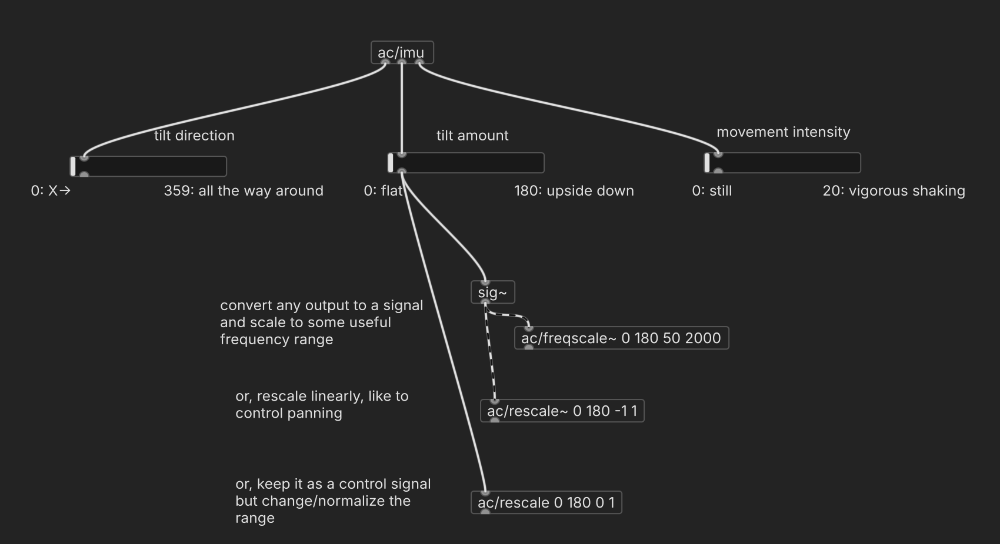
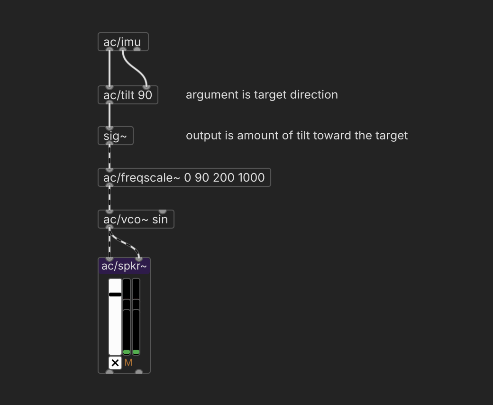
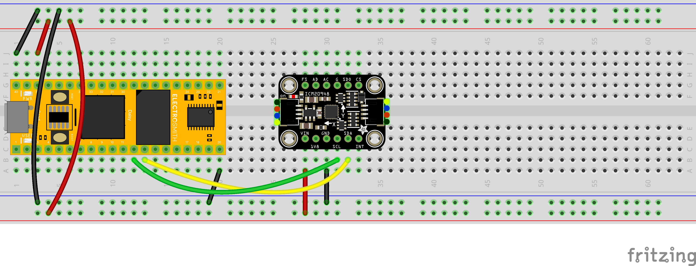
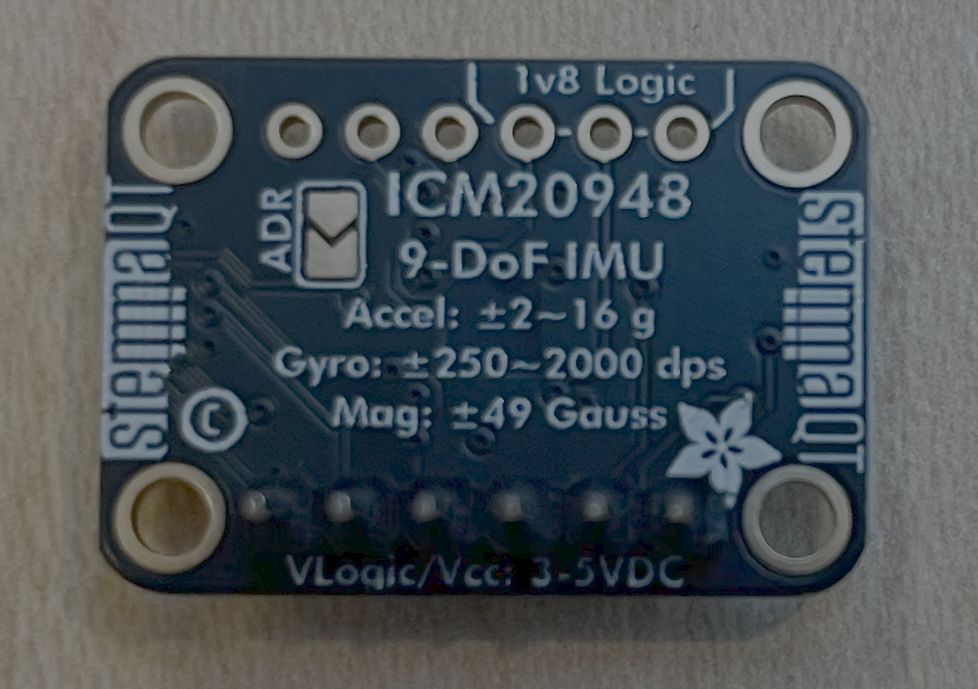
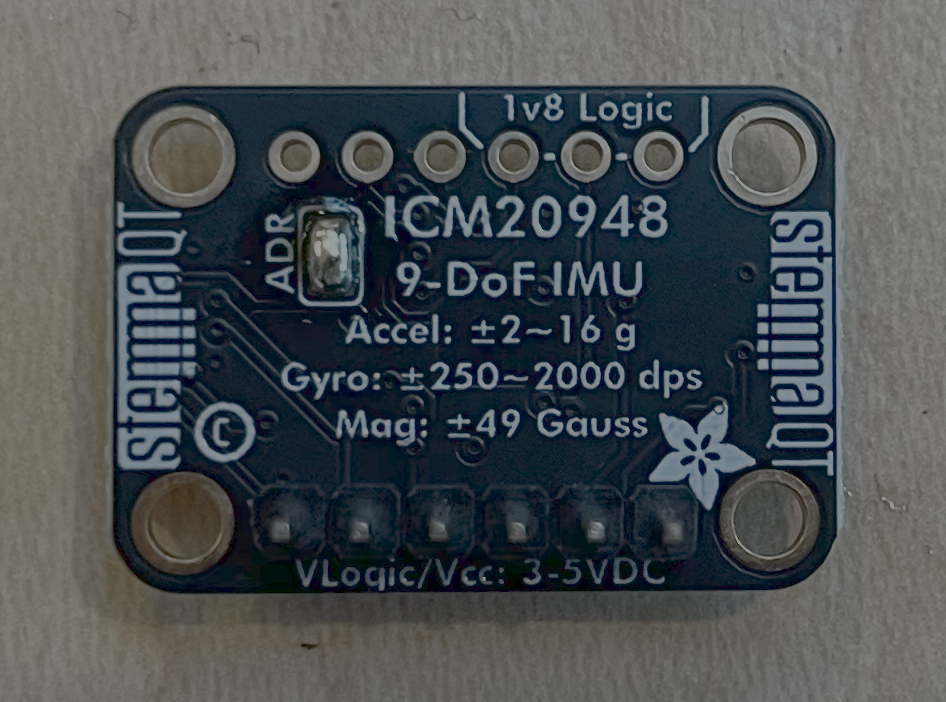
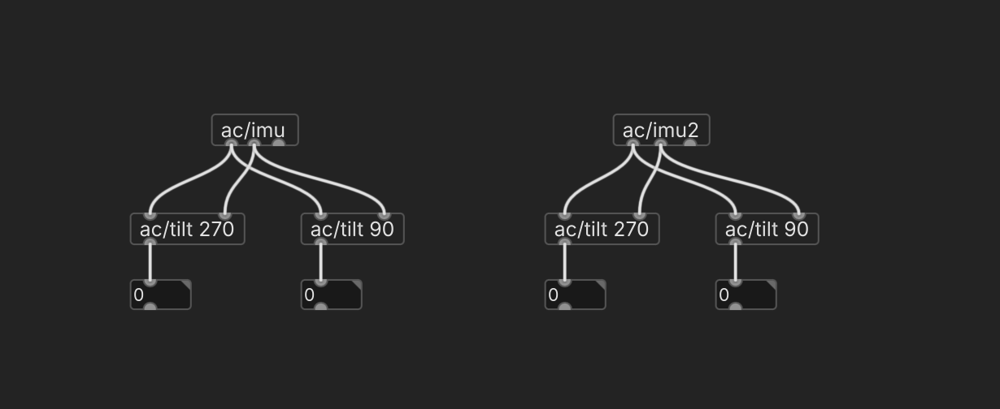
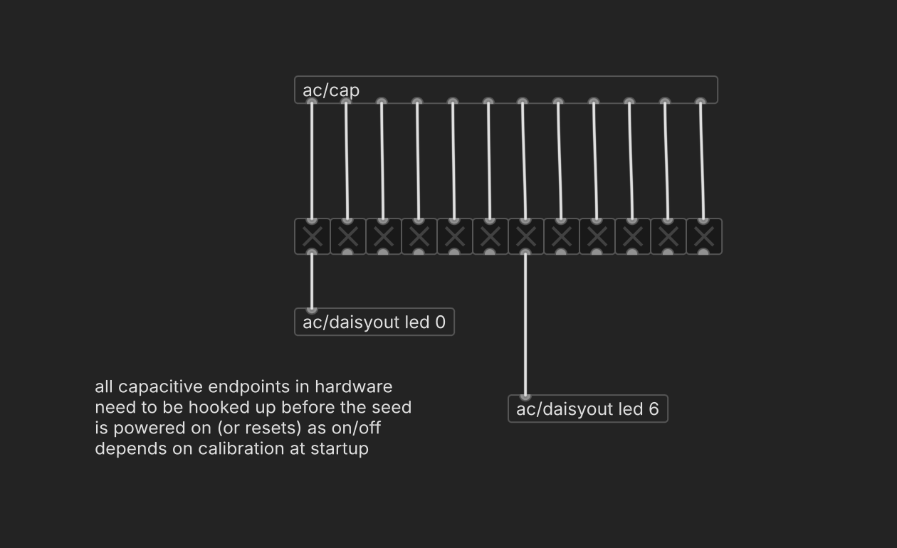
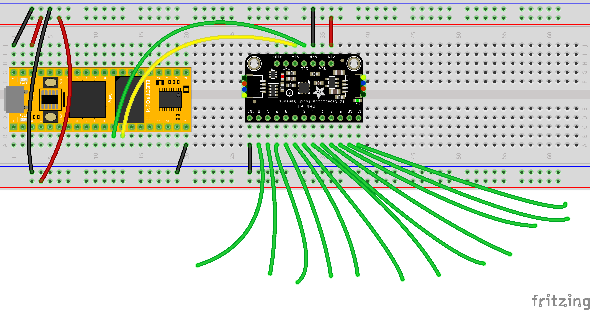

# Digital Sensors

Some sensors are not just basic voltage dividers but include their own chips with specialized processing. In these cases, the result is not just a scalar stream of values, but several processed values. The Daisy can work with sensors like these by receiving data through its "I2C protocol bus"—the digital connection on the SDA/SCL pins.


Here's the pinout for reference:

<p align="center">
    
</p>


## IMU ([object](https://github.com/brianhouse/ac/blob/main/imu.pd), [help](https://github.com/brianhouse/ac/blob/main/imu-help.pd))

An "inertial measurement unit sensor" includes an accelerometer, gyroscope, and magnetometer to determine how it is oriented in space.

Our implementation focuses on the accelerometer and outputs three streams of values:
- Tilt Direction, 0–360 degrees
- Tilt Amount, from 0 (flat) to 180 (upside down)
- Movement Intensity, from 0 (still) to 20 (vigorous shaking)

With this, you can control characteristics of your patch by tilting it in different directions by certain amounts, and changing the tilt suddenly or over time.

### compile.json

Use SDA and SCL pins:
```json
        "imu": {
            "component": "Icm20948",
            "pin": { "sda": 12, "scl": 11 }
        },
```

### Pd

Connect `ac/imu` to several sliders (adjust their ranges in properties):


<p align="center">
    
</p>

In many cases, you may want to know how far the imu is tilted in a given direction. For this, connect the tilt direction and tilt amount outputs to `ac/tilt`, which will then give you a single number to work with.

<p align="center">
    
</p>


### Daisy

Wire the VIN to `+`, GND to `-`, and the `SDA` and `SCL` pins on the IMU to the respective pins on the Daisy.


<p align="center">
    
</p>


### A second IMU ([object](https://github.com/brianhouse/ac/blob/main/imu2.pd))

To use two IMUs, a few things need to happen.

1. On the Icm20948 itself, to make it work as a second IMU, you need to solder a jumper connection on back. Add a dolop of solder to the two heated pads to make them connect, as shown:
<p align="center">
    
</p>
<p align="center">
    
</p>

2. In `compile.json`, add:
```json
        "imu2": {
            "component": "Icm20948",
            "pin": { "sda": 12, "scl": 11 },
            "address": "0x68"
        },
```
3. In your patch, use `ac/imu2` for the second IMU.

<p align="center">
    
</p>


## Capacitance ([object](https://github.com/brianhouse/ac/blob/main/cap.pd), [help](https://github.com/brianhouse/ac/blob/main/cap-help.pd))

With the Mpr121 sensor, a change in capacitance at any of the pad pin ends controls a toggle in Pd. In other words, wire something conductive to the pin, and then touch it with your finger or some other conductive material. You get 12 custom toggle switches in one!


### compile.json

Use SDA and SCL pins:
```json
        "cap": {
            "component": "Mpr121",
            "mapping": [{"name": "{name}", "get": "(float){class_name}.{name}.Touched()", "where": "main"}]
        },
```

### Pd

Connect `ac/cap` to several toggles:


<p align="center">
    
</p>

### Daisy

Wire the VIN to `+`, GND to `-`, and the `SDA` and `SCL` pins on the sensor to the respective pins on the Daisy. For each of the pad pins, add a bare wire and/or connect it to something conductive.


<p align="center">
    
</p>