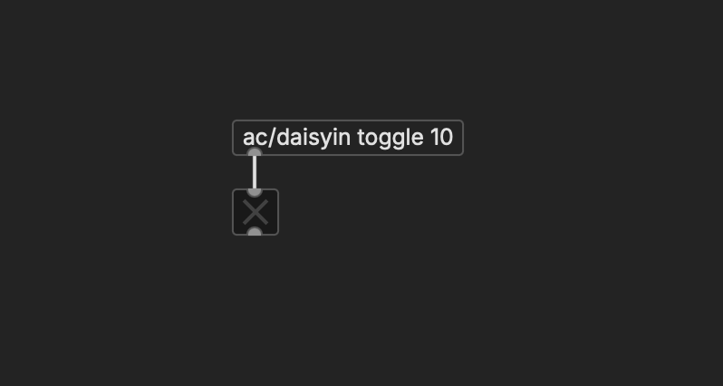
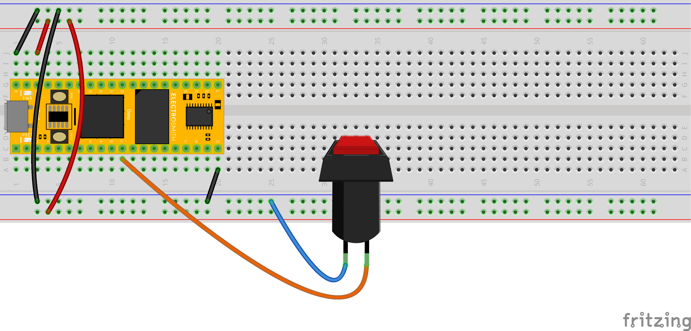
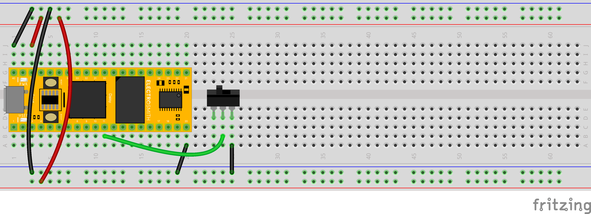
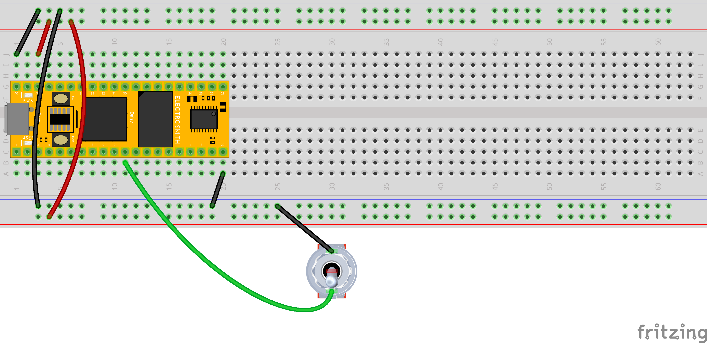
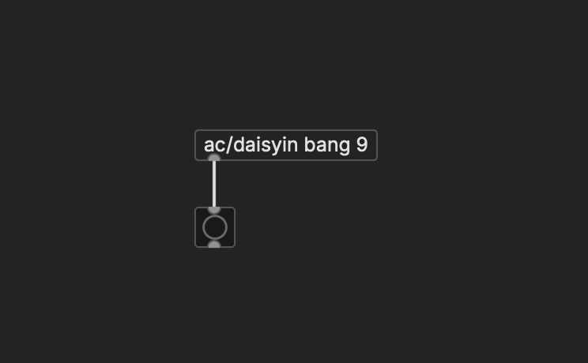
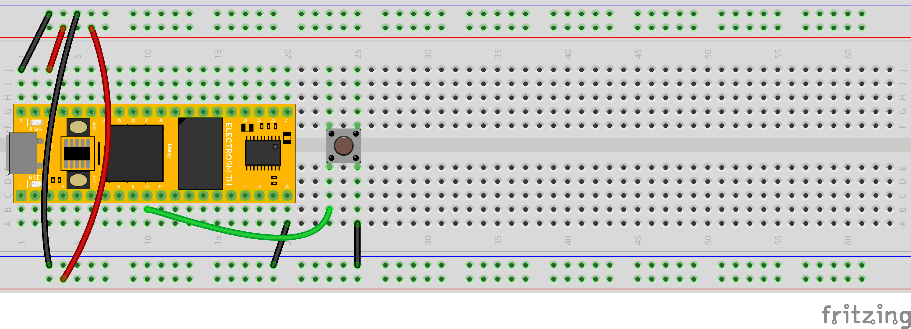
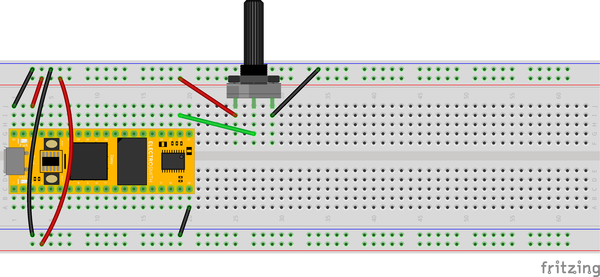
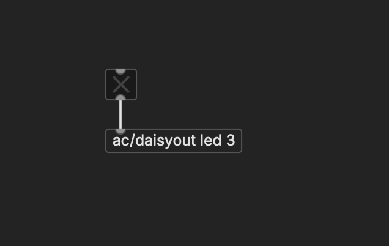
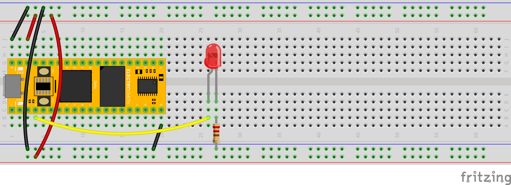

# Hardware Interfaces: Switches + Sliders (and Lights)

The Daisy allows us to integrate physical versions of the bangs, toggles, and sliders in our patches.


## compile.json

When we compile a Pd patch, it makes use of a special file, `compile.json`. This file provides a mapping between what is connected to the Daisy and how it is understood in our patches. This is a plain text document, in JSON format.

A basic `compile.json` might look like this:

```json
{
   "name": "HelloWorld",
   "som": "seed",
   "audio": {
     "channels": 2
   },
   "components": {
       "toggle10": {
           "component": "Switch",
           "pin": 10
       },
       "bang9": {
            "component": "Switch",
            "pin": 9
       },
       "slider15": {
           "component": "AnalogControl",
           "pin": 15
       },
       "led3": {
            "component": "Led",
            "pin": 3
       },       
       "led0": {
            "component": "UserLed"
       }
   }
}
```

JSON is a bit of a confusing file format with all the brackets and commas. But notice that there is a component section, which lists the various interface objects in Pd that we are connecting to a pin on the Daisy. By adding components to `compile.json` and including `daisyin` and `daisyout` objects in our patches, we can make a ton of customized connections.

To do so, we'll be referencing our pinout:

<p align="center">
    
</p>


## Switch: Toggle

Links a hardware toggle switch or momentary button to a toggle object in Pd. Receive a 1 (on) or a 0 (off) when the hardware changes position.

### compile.json

Replace `X` in both places with the appropriate pin. Any analog or digital pin can be used:
```json
       "toggleX": {
           "component": "Switch",
           "pin": X
       },
```

### Pd

Connect `ac/daisyin toggle X` to a toggle object:


<p align="center">
    
</p>


### Daisy

Wire one side of any kind of switch to `-` and the other to any analog or digital pin:

<p align="center">
    
</p>

<p align="center">
    
</p>

<p align="center">
    
</p>

<p align="center">
    
</p>


## Switch: Bang

Links a button to a bang object in Pd. Receive a bang when the button is pressed.


### compile.json

Replace `X` in both places with the appropriate pin. Any analog or digital pin can be used:
```json
       "bangX": {
           "component": "Switch",
           "pin": X
       },
```

### Pd

Connect `ac/daisyin bang X` to a bang button

<p align="center">
    
</p>


### Daisy

Wire one side of the button to `-` and the other to any analog or digital pin:

<p align="center">
    
</p>

<p align="center">
    
</p>


## Slider

Links a dial or other variable resistor to a slider object in Pd. Receive a stream of values between 0 and 1 when moved.


### compile.json

Replace `X` in both places with the appropriate pin. Only analog pins can be used:
```json
       "slider15": {
           "component": "AnalogControl",
           "pin": 15
       },
```


### Pd

Connect `ac/daisyin slider X` to a slider with a minimum of 0.0 and maximum of 1.0 set in its properties:

<p align="center">
    
</p>


### Daisy

Wire the outer legs of a potentiometer to `+` and `-` (which is which will determine the direction the slider moves). The center pin goes to an analog pin.

<p align="center">
    
</p>


## LED

Links an external LED to a toggle object in Pd. This is "output" mode, in which the Daisy turns on and off a pin to light the LED.


### compile.json

Replace `X` in both places with the appropriate pin. Only analog pins can be used:
```json
       "ledX": {
            "component": "Led",
            "pin": X
       },
```


### Pd

Connect a toggle to `ac/daisyout led X`:

<p align="center">
    
</p>


### Daisy

The longer leg of the LED connects to the pin on the Daisy that will power it. The shorter leg goes to `-`, but it **must** go through a resistor. 220Ω (red red brown gold) is standard; 100Ω (brown black brown) is ok for blue and green LEDs if they are otherwise too dim.

<p align="center">
    
</p>

