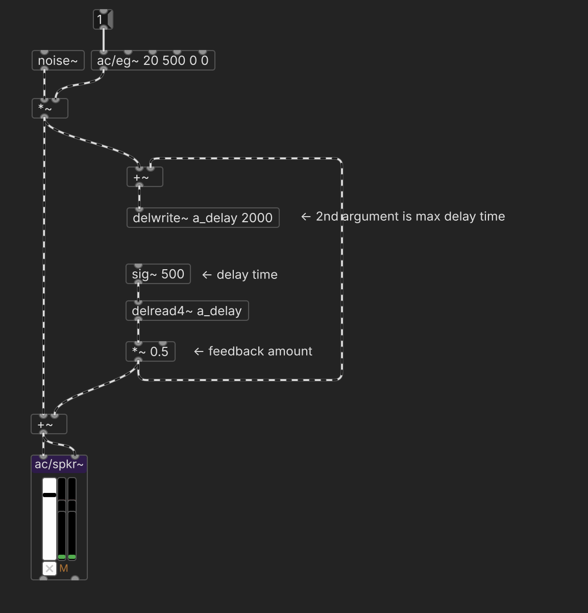
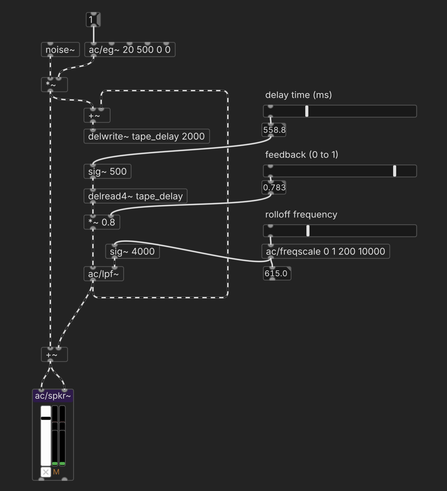
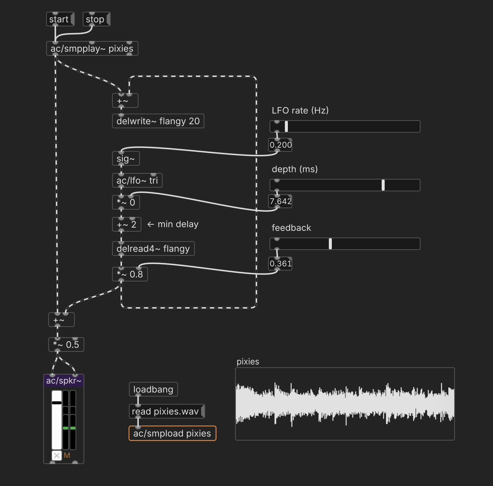
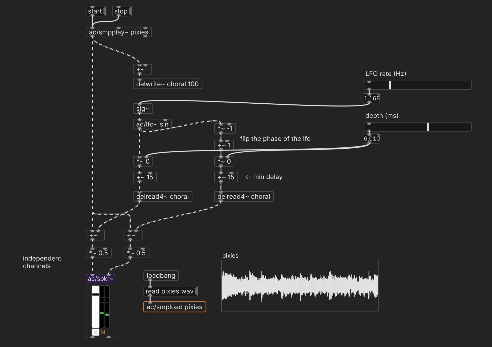
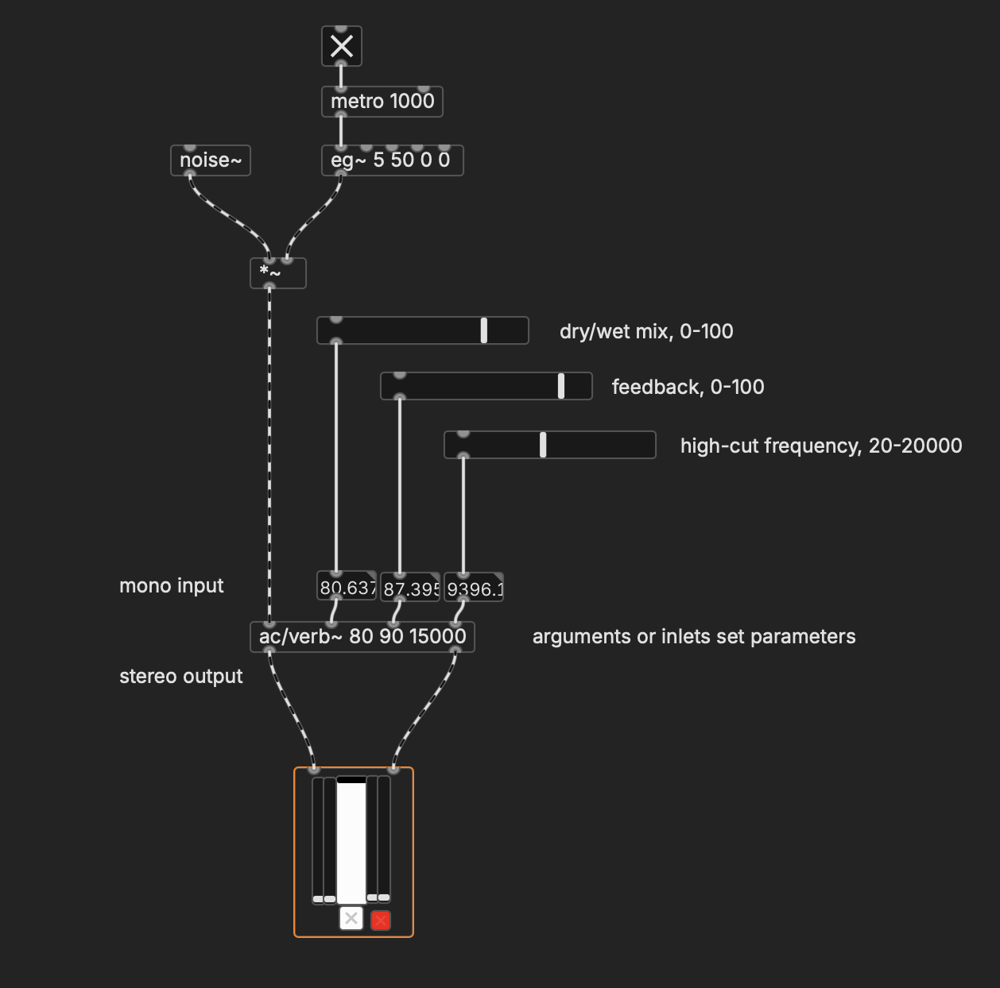

# Delay

One foundational technique in programming digital audio is delay. By capturing audio, delaying it, and routing some proportion of it back into itself, we can change the overall character of a sound in several ways.

## Basic delay line

Pd provides the `delwrite~` and `delread4~` objects, which allow us to construct a "delay line."

Send a sound source into `delwrite~` with an argument for the name of the delay line ("a_delay")—much like naming an array. We also provide the maximum delay time, which determines the size of the audio buffer behind the scenes. This captures the signal.

On the other end, we have `delread4~` with the name of the delay line. This object outputs the delayed audio, and by sending it a number, we can adjust that delay time (up until the maximum delay time specified by `delwrite~`).

We can make a basic delay effect by multiplying the output of `delread4~` by some fraction and then adding it back into `delwrite~`.

   

## Tape echo

To make a [classic "analog" tape echo effect](https://en.wikipedia.org/wiki/Roland_Space_Echo) (essential to genres like dub reggae), we'll add a low-pass filter to the delayed signal. This simulates the loss of high-end that happens with analog media, and which also happens with acoustic echoes (such as yelling across a canyon).

   

## Flange

"Flange" is also a delay effect, [popularized by the Beatles with their "Revolver" album](https://en.wikipedia.org/wiki/Flanging). In this case, we use a very short delay time, and we continuously vary it with an LFO. In the example below, the minimum delay time is 2ms, and the max is determined by a "depth" parameter. We use a `tri` shape for the LFO, and can change the rate.

   

## Stereo chorus

"Chorus" is basically the same thing as flange, but with a longer delay time and no feedback. However, it can also be set up as a stereo effect, with multiple delay lines that are out of phase with each other:

   

## Reverb

When sound reverberates in a space, tons of little delayed sounds are produced as the waves bounce off of the walls. The characteristics of the space determine the nature of those delays, and it's why a small, carpeted office sounds so different than a large concert hall. 

"[Reverb](https://en.wikipedia.org/wiki/Reverb_effect)" is a simulation of all those delays. The history of reverb is a huge topic, as engineers moved from using actual physical spaces to spring tanks, metal plates, and electronic components.

Building a reverb from scratch is probably more than you want to get involved with. `ac/verb~` can work for most basic purposes. It works by delaying a signal many times and feeding the results back into itself—just like the bouncing echoes. `ac/verb~` takes three parameters: the percent mix between the "dry" and "wet" signals, the feedback amount, and rolloff frequency, which, similar to tape delay, simulates how higher frequencies will be absorbed by a room rather than reflected by it.

Note that `ac/verb~` takes a mono signal and outputs a stereo one, distributing the reflections around the stereo field.

   

